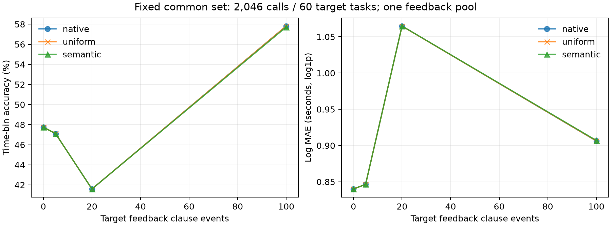

# ClawTune：冻结 KB 评估、误差归因与优化实验

日期：2026-10-13。正式预测、训练、调参、真实 API、Docker help 与回归测试均在 Kunpeng 执行。

## 1. 六个问题的直接结论

1. **不能据全工具排名认定 ToolKB 算法最好；共同 shell 留出集没有明确的准确率赢家，Lattice shrinkage 的连续耗时误差更好。** 16,260 个调用中有 9,717 个非 shell 调用，其他三类 KB 均在入口返回 `not_a_shell_command`。仅看 shell，覆盖率为 ToolKB 99.89%、其他三者约 95.7%。原测试集共同覆盖的 1,208 个 shell 调用，Tool/Trie/Lattice/Edge 准确率分别为 71.77%/71.69%/71.44%/70.12%，Log MAE 为 0.480/0.442/0.385/0.442；Tool 比 Trie 只多预测对 1 个。原测试集非 shell 调用始终预测最低档即可达到 99.84% 准确率。全量含训练任务、冻结模型配置不同，不能据此判断算法普遍优劣。分组和配对不确定性见 `results/reassessment-scope.json`，由 `reassessment.py` 在 Kunpeng 重算。
2. **Top-30 的主要问题是条件分支合成、同签名混合不同运行状态，以及未见测试范围的粗粒度回退。** 两组共 60 个条目中未证明 KB 预测实现 Bug；发现并修复了独立的规则生成 fixture 校验 Bug。缺规则并不自动等于误差主因；已有精确签名也会出现百秒级低估。
3. **Edge 权重参与聚合，但本实验没有验证它学到了可迁移的参数重要性。** 原生→Uniform 改变 608 个点预测、975 个桶概率向量，却改变 0 个最终桶；节点和父集始终不变。原始留出集原生 Log MAE 仅优约 0.000022，未转化为分桶或跨仓库收益。
4. **没有获得可靠的权重调优或 LLM 初始化收益。** 开发集选择 k0=3，目标仓库九种配置预测相同。少量本地反馈曲线非单调；100 条反馈提高分桶准确率，但 Log MAE 变差，不能称为全面改善或 LLM 降低样本需求。
5. **真实 DeepSeek 已完成自动排队→规则生成→校验→缓存激活→特征变化→重建 KB→预测变化。** 修复前 0/6、修复后 4/6 工具规则通过；这是两次真实随机生成批次，成功率差异不是单独的受控因果估计。正确模块 fixture 的确定性红绿复现单独证明工程修复。生成规则提升可解析性，却未提升 Coverage，目标仓库 Edge/Lattice 准确率均下降约 0.166 个百分点。
6. **工程优先级是保留确定性 fixture 修复和生产路径一致性校验；方法研究优先级是“可观测工作量/失败模式 + 条件执行分布 + 可迁移稀疏证据”。** 当前数据不支持把 Edge 节点局部 κ 当成已验证的全局参数重要性，也不支持把语法生成本身包装为预测性能创新。

## 2. 环境、数据、快照和评估口径

### 2.1 环境与版本

- SSH：`kunpeng`；独立工作目录 `/home/weitianc/clawtune-kb-systematic-20261013`。
- Python：`/home/weitianc/ClawTune/.venv/bin/python`，3.11.6，Linux aarch64；NumPy 2.4.6。`PYTHONHASHSEED=42`。
- 起点 Git HEAD：`664679885768edacf6caec23c7d3044fbfe4b879`，工作区原本已有修改；真正源码身份由 `export.json` 和 `source.zip` 决定，不能只用 HEAD 重建。
- 选用最近完整可加载的四 KB 同批 seed：`.runtime/offline/kb-methods-fixed6-20261012-r2/seed`，另存 `baseline.zip`。服务器原项目状态更旧且不完整；没有把新训练模型替换为原始基线。
- **目录名不代表模型实际配置：Lattice 阶数 6，Edge 快照阶数 1。** Edge 的 12,450 个节点、29,280 条边来自已有快照；独立优化模型固定阶数 6（62,051 节点、218,259 边）。比较现有快照与比较等配置算法是两件事；本报告不把二者混同。
- Edge 原文件中的 max_graph_nodes/max_covered_nodes 是兼容历史字段，当前加载器移除它们；它们不是本次执行仍在强制的容量上限。保留的有效阶数、历史图和权重没有被重建覆盖。
- 原始数据只读，未修改 OpenClaw core、agent-test-bench 或 `tool_resource`。

四个模型都通过实际加载及预测；冻结评估不调用 observe/begin/complete/commit。消融只修改独立内存边副本，结束恢复原生边。`freeze-verification.json` 的文件哈希及序列化状态前后一致，test_updates=0。查询预备索引允许作为派生缓存构造，不代表追加证据。

### 2.2 数据和标签

644 个 v5 trace 文件，631 个唯一任务，271 个仓库；28,860 个原始 tool_action，16,260 个有效耗时调用。644 个源文件 SHA256 与原始 split 清单全部一致。12,600 个调用没有项目要求的耗时标签，排除而不填 0。

复用 `offline.runner.load_task/_call_actuals` 和 `cold_start.flat_loader`：shell 调用以 **retained workload duration** 为目标，要求合格的 clause telemetry；单子句采用其正耗时，多子句要求合法时间轴来合成，不能用包含 hook 的 action.duration_ms 替代。非 shell 工具使用合法 action.duration_ms，真实 0 保留。记录 16,463 条可加载 clause observations；权重学习另走 `offline.edge_kappa_trace.read_v5_events`，得到 13,462 条有真实时间戳的严格 clause events。该路径排除 unsupported_shell_clause=3,004、ineligible_resource_observation=728、no_exact_clause_duration=10；这些计数属于不同过滤层，不能直接与调用数相减。

调用准备后的 parser 子句状态为 complete=10,014、partial=6,584、invalid=75（16,673 条，和执行 telemetry 条数不是同一母集）。strict events 仅来自 SQLGlot 8,219 条与 PennyLane 5,243 条；“271 仓库”不能当作 271 个可用于 clause 权重泛化的仓库。CPU/RSS 的所有权、时间窗口与标签缺失条件不同，本研究不把其指标混入耗时评估。

### 2.3 重叠、隔离和选择纪律

原始 seed 使用 seed42 的 515 训练任务、116 测试任务。全量 16,260 调用中含训练任务；原始测试 3,185 调用不参与此次基线更新，但已被项目历史研究使用，不宣称全新盲测。

在调参前先按仓库 hash 划分；发现开发集没有严格 clause 标签后，仅根据标签可用性和已有任务 split 修正：SQLGlot 163 任务/6,568 events/5,433 调用训练，41 任务/1,651 events/1,442 调用开发；PennyLane 70 任务/5,243 events/3,675 调用作目标测试；其他 357 任务/5,710 调用为 auxiliary。保存初始与最终划分，训练模型完全重建，不使用原 seed 的目标仓库证据。主选择 `selection-lock.json` 和迁移选择 `transfer-lock.json` 在各自目标评估前写入；全量最坏案例在选择锁定后检查，没有据其重新调参。

这是**协议隔离的回顾性跨仓库实验**，只有一个源仓库、一个目标仓库，不是全新未接触语料上的多仓库泛化证明。目标反馈曲线另取 10 个 hash 固定任务作反馈池，其余 60 任务固定测试；反馈任务与评价任务无交叉。

### 2.4 指标

统一边界来自项目 `load_bucket_edges`：毫秒 `[100,500,2000,10000]`，即 B0=[0,0.1)、B1=[0.1,0.5)、B2=[0.5,2)、B3=[2,10)、B4=[10,+∞) 秒。边界属于右桶；不是此前 0.6/2/10/60 秒方案。

- Coverage = 有限非负点预测数 / 有效调用数。
- Acc 与 Macro 表默认在各方法可预测样本上计算；单独给出不可预测按错误计入的全样本 Acc、Macro 与逐桶 Recall。
- 桶预测是生产路径桶概率的 argmax（同概率取较小桶），**不一定是 p50 所在桶**。实际桶采用 bisect_right。
- MAE 与 Median AE 使用 p50 和真实秒数；Log MAE = mean(abs(log1p(p50秒)−log1p(真实秒)))；零耗时不加伪观测。
- Factor2 采用 0.5y≤p≤2y，y=0 时只接受 p=0；Severe 为桶距离≥2。
- 缺失预测不算为 0 秒，不混入误差均值；共同集合取所有 11 个调用级方法可预测 ID 的交集。
- 多阶段复用生产 `compose` 的 2,048 次固定随机抽样：串行求和、流水阶段取最大，保留其独立边际/全部阶段执行假设。此近似本身就是部分误差来源。

原始命令生产路径抽查发现实验适配器曾遗漏动态执行拒绝条件，已更正 36 条带该诊断的调用；初检 4 方法中有 87 个差异（29 调用×3 clause 方法）。旧输出保留在 `adapter-before-guard-fix/`；正式表为修正后，选择配置不变。最终 164 调用×4 后端=656 次生产一致性检查 0 差异。这是本次实验代码缺陷，不是把它记成 KB 预测 Bug。

## 3. 全部方法及公平指标

### 3.1 实现清单

调用级：ToolKB（`tool_resource/runtime_kb.py:RuntimeToolResourceKB`，调用历史分层回退）、TrieKB（同文件 `ClauseResourceKB`，精确子句/有序 argv 前缀/执行身份约束回退，前缀最大深度4）、Lattice shrinkage/loso/max_cardinality（`tool_time/lattice_kb.py`、`query.py`）、EdgeKappa（`edge_kappa_kb/kb.py`）及 Uniform/shared/shuffled/random/no_weights 消融。

兼容接口：Lattice `_predict_clause/predict_clauses` 的三种 point selector；`subset_coverage=False` 旧构建语义独立复制后比较；`offline.edge_kappa_legacy` 是上述 Lattice point 路径的 bucket 包装，不是另一个已有训练模型。`offline.lattice_oracle` 用真实标签选择候选，只能当事后 oracle，不能进入可部署排名。CPU/memory 资源路径不作为额外耗时模型。

Uniform=每条父边 k0/父数；shared=保持原生每 child 总 κ、父边均分；shuffled=每 child 内打乱；random=log-uniform 后归一到 k0（seed42）；no_weights=相同去重证据集合每事件权重 1。最后一种同时撤销样本数量校正，**不是纯粹取消“学习”**；它的劣化不能证明学到参数重要性。

### 3.2 全量（含原训练任务）

| 方法 | N / 可预测 | Coverage % | Acc % | Macro % | MAE(s) | Median AE(s) | Log MAE | Factor2 % | Severe % |
|---|---:|---:|---:|---:|---:|---:|---:|---:|---:|
| tool | 16260 / 16252 | 99.951 | 96.025 | 87.145 | 2.242912 | 0.000200 | 0.078399 | 91.066 | 1.932 |
| trie | 16260 / 6263 | 38.518 | 83.890 | 74.980 | 6.310515 | 0.004656 | 0.229898 | 80.952 | 4.950 |
| lattice_shrinkage | 16260 / 6262 | 38.512 | 81.939 | 73.285 | 6.869656 | 0.008845 | 0.258207 | 78.202 | 6.835 |
| lattice_loso | 16260 / 6266 | 38.536 | 81.870 | 73.174 | 7.035556 | 0.008929 | 0.261118 | 78.024 | 6.815 |
| lattice_max_cardinality | 16260 / 6266 | 38.536 | 81.918 | 73.270 | 7.093064 | 0.008967 | 0.260340 | 78.152 | 6.846 |
| edge_native | 16260 / 6266 | 38.536 | 80.290 | 71.413 | 8.069368 | 0.011053 | 0.304837 | 76.285 | 7.772 |
| edge_uniform | 16260 / 6266 | 38.536 | 80.290 | 71.413 | 8.071204 | 0.011078 | 0.304984 | 76.285 | 7.772 |
| edge_shared | 16260 / 6266 | 38.536 | 80.290 | 71.413 | 8.070952 | 0.011053 | 0.304981 | 76.285 | 7.772 |
| edge_shuffled | 16260 / 6266 | 38.536 | 80.290 | 71.413 | 8.071246 | 0.011053 | 0.305002 | 76.285 | 7.772 |
| edge_random | 16260 / 6266 | 38.536 | 80.354 | 71.505 | 8.066020 | 0.011205 | 0.303941 | 76.412 | 7.756 |
| edge_no_weights | 16260 / 6266 | 38.536 | 62.065 | 49.366 | 14.708844 | 0.391841 | 0.604488 | 51.229 | 17.204 |

缺失按错误计入；单元格为全样本召回 / 已覆盖 / 该桶总数：

| 方法 | 全样本 Acc % | 全样本 Macro % | B0 召回/覆盖/总数 | B1 | B2 | B3 | B4 |
|---|---:|---:|---|---|---|---|---|
| tool | 95.978 | 87.004 | 99.572% / 12617 / 12619 | 88.547% / 582 / 585 | 79.138% / 1019 / 1021 | 79.847% / 918 / 918 | 87.914% / 1116 / 1117 |
| trie | 32.312 | 57.907 | 21.135% / 2750 / 12619 | 38.120% / 544 / 585 | 70.813% / 981 / 1021 | 70.479% / 885 / 918 | 88.988% / 1103 / 1117 |
| lattice_shrinkage | 31.556 | 56.504 | 20.715% / 2752 / 12619 | 38.291% / 544 / 585 | 71.890% / 981 / 1021 | 67.647% / 886 / 918 | 83.975% / 1099 / 1117 |
| lattice_loso | 31.550 | 56.458 | 20.715% / 2752 / 12619 | 38.291% / 544 / 585 | 71.890% / 981 / 1021 | 66.885% / 886 / 918 | 84.512% / 1103 / 1117 |
| lattice_max_cardinality | 31.568 | 56.556 | 20.707% / 2752 / 12619 | 38.291% / 544 / 585 | 71.890% / 981 / 1021 | 67.647% / 886 / 918 | 84.244% / 1103 / 1117 |
| edge_native | 30.941 | 54.994 | 20.382% / 2752 / 12619 | 34.188% / 544 / 585 | 74.927% / 981 / 1021 | 65.795% / 886 / 918 | 79.678% / 1103 / 1117 |
| edge_uniform | 30.941 | 54.994 | 20.382% / 2752 / 12619 | 34.188% / 544 / 585 | 74.927% / 981 / 1021 | 65.795% / 886 / 918 | 79.678% / 1103 / 1117 |
| edge_shared | 30.941 | 54.994 | 20.382% / 2752 / 12619 | 34.188% / 544 / 585 | 74.927% / 981 / 1021 | 65.795% / 886 / 918 | 79.678% / 1103 / 1117 |
| edge_shuffled | 30.941 | 54.994 | 20.382% / 2752 / 12619 | 34.188% / 544 / 585 | 74.927% / 981 / 1021 | 65.795% / 886 / 918 | 79.678% / 1103 / 1117 |
| edge_random | 30.966 | 55.095 | 20.366% / 2752 / 12619 | 34.017% / 544 / 585 | 75.220% / 981 / 1021 | 66.013% / 886 / 918 | 79.857% / 1103 / 1117 |
| edge_no_weights | 23.918 | 35.242 | 18.282% / 2752 / 12619 | 15.043% / 544 / 585 | 55.044% / 981 / 1021 | 24.728% / 886 / 918 | 63.115% / 1103 / 1117 |

共同可预测集合：**6255 / 16260 = 38.469%**。

| 方法 | N / 可预测 | Coverage % | Acc % | Macro % | MAE(s) | Median AE(s) | Log MAE | Factor2 % | Severe % |
|---|---:|---:|---:|---:|---:|---:|---:|---:|---:|
| tool | 6255 / 6255 | 100.000 | 90.264 | 87.220 | 5.691757 | 0.000000 | 0.197063 | 87.450 | 4.764 |
| trie | 6255 / 6255 | 100.000 | 83.917 | 74.988 | 6.200634 | 0.004598 | 0.229192 | 80.975 | 4.956 |
| lattice_shrinkage | 6255 / 6255 | 100.000 | 81.998 | 73.293 | 6.829466 | 0.008775 | 0.256805 | 78.241 | 6.811 |
| lattice_loso | 6255 / 6255 | 100.000 | 81.918 | 73.171 | 6.892845 | 0.008826 | 0.259459 | 78.066 | 6.795 |
| lattice_max_cardinality | 6255 / 6255 | 100.000 | 81.966 | 73.268 | 6.951080 | 0.008838 | 0.258685 | 78.193 | 6.827 |
| edge_native | 6255 / 6255 | 100.000 | 80.336 | 71.404 | 7.934617 | 0.010960 | 0.303292 | 76.323 | 7.754 |
| edge_uniform | 6255 / 6255 | 100.000 | 80.336 | 71.404 | 7.936456 | 0.010963 | 0.303440 | 76.323 | 7.754 |
| edge_shared | 6255 / 6255 | 100.000 | 80.336 | 71.404 | 7.936204 | 0.010960 | 0.303437 | 76.323 | 7.754 |
| edge_shuffled | 6255 / 6255 | 100.000 | 80.336 | 71.404 | 7.936498 | 0.010960 | 0.303458 | 76.323 | 7.754 |
| edge_random | 6255 / 6255 | 100.000 | 80.400 | 71.496 | 7.929426 | 0.011141 | 0.302381 | 76.451 | 7.738 |
| edge_no_weights | 6255 / 6255 | 100.000 | 62.142 | 49.417 | 14.488558 | 0.390701 | 0.600956 | 51.271 | 17.122 |

| 方法 | 全样本 Acc % | 全样本 Macro % | B0 召回/覆盖/总数 | B1 | B2 | B3 | B4 |
|---|---:|---:|---|---|---|---|---|
| tool | 90.264 | 87.220 | 98.399% / 2749 / 2749 | 90.775% / 542 / 542 | 79.388% / 980 / 980 | 79.548% / 885 / 885 | 87.989% / 1099 / 1099 |
| trie | 83.917 | 74.988 | 97.017% / 2749 / 2749 | 40.959% / 542 / 542 | 73.776% / 980 / 980 | 73.107% / 885 / 885 | 90.082% / 1099 / 1099 |
| lattice_shrinkage | 81.998 | 73.293 | 95.089% / 2749 / 2749 | 40.959% / 542 / 542 | 74.898% / 980 / 980 | 70.169% / 885 / 885 | 85.350% / 1099 / 1099 |
| lattice_loso | 81.918 | 73.171 | 95.089% / 2749 / 2749 | 40.959% / 542 / 542 | 74.898% / 980 / 980 | 69.379% / 885 / 885 | 85.532% / 1099 / 1099 |
| lattice_max_cardinality | 81.966 | 73.268 | 95.053% / 2749 / 2749 | 40.959% / 542 / 542 | 74.898% / 980 / 980 | 70.169% / 885 / 885 | 85.259% / 1099 / 1099 |
| edge_native | 80.336 | 71.404 | 93.561% / 2749 / 2749 | 36.531% / 542 / 542 | 78.061% / 980 / 980 | 68.249% / 885 / 885 | 80.619% / 1099 / 1099 |
| edge_uniform | 80.336 | 71.404 | 93.561% / 2749 / 2749 | 36.531% / 542 / 542 | 78.061% / 980 / 980 | 68.249% / 885 / 885 | 80.619% / 1099 / 1099 |
| edge_shared | 80.336 | 71.404 | 93.561% / 2749 / 2749 | 36.531% / 542 / 542 | 78.061% / 980 / 980 | 68.249% / 885 / 885 | 80.619% / 1099 / 1099 |
| edge_shuffled | 80.336 | 71.404 | 93.561% / 2749 / 2749 | 36.531% / 542 / 542 | 78.061% / 980 / 980 | 68.249% / 885 / 885 | 80.619% / 1099 / 1099 |
| edge_random | 80.400 | 71.496 | 93.489% / 2749 / 2749 | 36.347% / 542 / 542 | 78.367% / 980 / 980 | 68.475% / 885 / 885 | 80.801% / 1099 / 1099 |
| edge_no_weights | 62.142 | 49.417 | 83.885% / 2749 / 2749 | 16.052% / 542 / 542 | 57.347% / 980 / 980 | 25.650% / 885 / 885 | 64.149% / 1099 / 1099 |

### 3.3 原始任务留出集

| 方法 | N / 可预测 | Coverage % | Acc % | Macro % | MAE(s) | Median AE(s) | Log MAE | Factor2 % | Severe % |
|---|---:|---:|---:|---:|---:|---:|---:|---:|---:|
| tool | 3185 / 3180 | 99.843 | 88.302 | 62.789 | 5.164415 | 0.000723 | 0.192896 | 78.553 | 4.969 |
| trie | 3185 / 1211 | 38.022 | 71.594 | 58.778 | 12.977400 | 0.154021 | 0.445193 | 64.244 | 9.001 |
| lattice_shrinkage | 3185 / 1212 | 38.053 | 71.287 | 59.160 | 11.309906 | 0.161563 | 0.390738 | 65.759 | 10.479 |
| lattice_loso | 3185 / 1213 | 38.085 | 70.899 | 58.587 | 11.995820 | 0.163052 | 0.406113 | 65.210 | 10.470 |
| lattice_max_cardinality | 3185 / 1213 | 38.085 | 71.146 | 59.050 | 12.329113 | 0.167395 | 0.401742 | 65.540 | 10.552 |
| edge_native | 3185 / 1213 | 38.085 | 69.992 | 57.389 | 12.902401 | 0.160572 | 0.448154 | 63.314 | 11.212 |
| edge_uniform | 3185 / 1213 | 38.085 | 69.992 | 57.389 | 12.902444 | 0.160572 | 0.448176 | 63.314 | 11.212 |
| edge_shared | 3185 / 1213 | 38.085 | 69.992 | 57.389 | 12.902487 | 0.160572 | 0.448167 | 63.314 | 11.212 |
| edge_shuffled | 3185 / 1213 | 38.085 | 69.992 | 57.389 | 12.902474 | 0.160572 | 0.448162 | 63.314 | 11.212 |
| edge_random | 3185 / 1213 | 38.085 | 69.992 | 57.389 | 12.904157 | 0.158647 | 0.447925 | 63.314 | 11.212 |
| edge_no_weights | 3185 / 1213 | 38.085 | 59.769 | 46.638 | 15.049330 | 0.392347 | 0.606246 | 51.360 | 17.890 |

缺失按错误计入；单元格为全样本召回 / 已覆盖 / 该桶总数：

| 方法 | 全样本 Acc % | 全样本 Macro % | B0 召回/覆盖/总数 | B1 | B2 | B3 | B4 |
|---|---:|---:|---|---|---|---|---|
| tool | 88.163 | 62.453 | 98.182% / 2475 / 2475 | 57.143% / 117 / 119 | 36.275% / 202 / 204 | 50.276% / 181 / 181 | 70.388% / 205 / 206 |
| trie | 27.221 | 42.139 | 20.606% / 532 / 2475 | 27.731% / 108 / 119 | 46.569% / 193 / 204 | 38.122% / 175 / 181 | 77.670% / 203 / 206 |
| lattice_shrinkage | 27.127 | 42.853 | 20.081% / 533 / 2475 | 25.210% / 108 / 119 | 56.863% / 193 / 204 | 39.779% / 176 / 181 | 72.330% / 202 / 206 |
| lattice_loso | 27.002 | 42.370 | 20.081% / 533 / 2475 | 25.210% / 108 / 119 | 56.863% / 193 / 204 | 35.912% / 176 / 181 | 73.786% / 203 / 206 |
| lattice_max_cardinality | 27.096 | 42.844 | 20.040% / 533 / 2475 | 25.210% / 108 / 119 | 56.863% / 193 / 204 | 39.779% / 176 / 181 | 72.330% / 203 / 206 |
| edge_native | 26.656 | 41.427 | 19.838% / 533 / 2475 | 19.328% / 108 / 119 | 60.294% / 193 / 204 | 39.227% / 176 / 181 | 68.447% / 203 / 206 |
| edge_uniform | 26.656 | 41.427 | 19.838% / 533 / 2475 | 19.328% / 108 / 119 | 60.294% / 193 / 204 | 39.227% / 176 / 181 | 68.447% / 203 / 206 |
| edge_shared | 26.656 | 41.427 | 19.838% / 533 / 2475 | 19.328% / 108 / 119 | 60.294% / 193 / 204 | 39.227% / 176 / 181 | 68.447% / 203 / 206 |
| edge_shuffled | 26.656 | 41.427 | 19.838% / 533 / 2475 | 19.328% / 108 / 119 | 60.294% / 193 / 204 | 39.227% / 176 / 181 | 68.447% / 203 / 206 |
| edge_random | 26.656 | 41.427 | 19.838% / 533 / 2475 | 19.328% / 108 / 119 | 60.294% / 193 / 204 | 39.227% / 176 / 181 | 68.447% / 203 / 206 |
| edge_no_weights | 22.763 | 32.421 | 17.980% / 533 / 2475 | 11.765% / 108 / 119 | 50.000% / 193 / 204 | 22.652% / 176 / 181 | 59.709% / 203 / 206 |

共同可预测集合：**1208 / 3185 = 37.928%**。

| 方法 | N / 可预测 | Coverage % | Acc % | Macro % | MAE(s) | Median AE(s) | Log MAE | Factor2 % | Severe % |
|---|---:|---:|---:|---:|---:|---:|---:|---:|---:|
| tool | 1208 / 1208 | 100.000 | 71.772 | 63.061 | 13.053191 | 0.169619 | 0.479820 | 59.768 | 11.838 |
| trie | 1208 / 1208 | 100.000 | 71.689 | 58.865 | 12.554381 | 0.152496 | 0.441968 | 64.321 | 9.023 |
| lattice_shrinkage | 1208 / 1208 | 100.000 | 71.440 | 59.169 | 11.107521 | 0.160671 | 0.385436 | 65.811 | 10.430 |
| lattice_loso | 1208 / 1208 | 100.000 | 71.026 | 58.567 | 11.414393 | 0.161563 | 0.399630 | 65.315 | 10.430 |
| lattice_max_cardinality | 1208 / 1208 | 100.000 | 71.275 | 59.033 | 11.752305 | 0.165794 | 0.395263 | 65.646 | 10.513 |
| edge_native | 1208 / 1208 | 100.000 | 70.116 | 57.359 | 12.347877 | 0.158446 | 0.442003 | 63.411 | 11.175 |
| edge_uniform | 1208 / 1208 | 100.000 | 70.116 | 57.359 | 12.347920 | 0.158446 | 0.442025 | 63.411 | 11.175 |
| edge_shared | 1208 / 1208 | 100.000 | 70.116 | 57.359 | 12.347963 | 0.158446 | 0.442016 | 63.411 | 11.175 |
| edge_shuffled | 1208 / 1208 | 100.000 | 70.116 | 57.359 | 12.347951 | 0.158446 | 0.442011 | 63.411 | 11.175 |
| edge_random | 1208 / 1208 | 100.000 | 70.116 | 57.359 | 12.340128 | 0.158281 | 0.441706 | 63.411 | 11.175 |
| edge_no_weights | 1208 / 1208 | 100.000 | 59.934 | 46.648 | 14.484038 | 0.390962 | 0.598491 | 51.407 | 17.715 |

| 方法 | 全样本 Acc % | 全样本 Macro % | B0 召回/覆盖/总数 | B1 | B2 | B3 | B4 |
|---|---:|---:|---|---|---|---|---|
| tool | 71.772 | 63.061 | 93.045% / 532 / 532 | 62.617% / 107 / 107 | 37.500% / 192 / 192 | 50.857% / 175 / 175 | 71.287% / 202 / 202 |
| trie | 71.689 | 58.865 | 95.865% / 532 / 532 | 30.841% / 107 / 107 | 49.479% / 192 / 192 | 39.429% / 175 / 175 | 78.713% / 202 / 202 |
| lattice_shrinkage | 71.440 | 59.169 | 93.421% / 532 / 532 | 27.103% / 107 / 107 | 60.417% / 192 / 192 | 41.143% / 175 / 175 | 73.762% / 202 / 202 |
| lattice_loso | 71.026 | 58.567 | 93.421% / 532 / 532 | 27.103% / 107 / 107 | 60.417% / 192 / 192 | 37.143% / 175 / 175 | 74.752% / 202 / 202 |
| lattice_max_cardinality | 71.275 | 59.033 | 93.233% / 532 / 532 | 27.103% / 107 / 107 | 60.417% / 192 / 192 | 41.143% / 175 / 175 | 73.267% / 202 / 202 |
| edge_native | 70.116 | 57.359 | 92.293% / 532 / 532 | 20.561% / 107 / 107 | 64.062% / 192 / 192 | 40.571% / 175 / 175 | 69.307% / 202 / 202 |
| edge_uniform | 70.116 | 57.359 | 92.293% / 532 / 532 | 20.561% / 107 / 107 | 64.062% / 192 / 192 | 40.571% / 175 / 175 | 69.307% / 202 / 202 |
| edge_shared | 70.116 | 57.359 | 92.293% / 532 / 532 | 20.561% / 107 / 107 | 64.062% / 192 / 192 | 40.571% / 175 / 175 | 69.307% / 202 / 202 |
| edge_shuffled | 70.116 | 57.359 | 92.293% / 532 / 532 | 20.561% / 107 / 107 | 64.062% / 192 / 192 | 40.571% / 175 / 175 | 69.307% / 202 / 202 |
| edge_random | 70.116 | 57.359 | 92.293% / 532 / 532 | 20.561% / 107 / 107 | 64.062% / 192 / 192 | 40.571% / 175 / 175 | 69.307% / 202 / 202 |
| edge_no_weights | 59.934 | 46.648 | 83.647% / 532 / 532 | 12.150% / 107 / 107 | 53.125% / 192 / 192 | 23.429% / 175 / 175 | 60.891% / 202 / 202 |

全量共同子集 Tool Acc=90.264%、Lattice=81.998%、Edge=80.336%；原始测试共同子集 Tool=71.772%、Trie=71.689%、Lattice=71.440%、Edge=70.116%。**不存在所有指标都最好的单一方法**：原始测试共同子集 Lattice Log MAE=0.385436，优于 Trie=0.441968、Edge=0.442003、Tool=0.479820。

以任务为 cluster 的 2,000 次配对 bootstrap（seed20261013，任务/调用 ID 排序固定）进一步比较原始测试：Lattice→Edge 的 Log MAE 差 +0.056240，95% CI=[0.031992,0.080108]；Acc 差 −1.320 个百分点，CI=[−2.826,0.166]。Lattice→Tool 的 Log MAE 差 +0.090015，CI=[0.034344,0.146434]；Acc 差的 CI 跨 0。这里是各对方法的共同子集（分别 1,212/1,210），不与上表 1,208 全方法共同集混同；bootstrap 只描述这些已观察仓库内的任务不确定性。

### 3.4 兼容 point 接口（独立 clause 目标）

以下 13,462 个真实 clause events 与主表调用目标不同。point 值直接分桶；完整逐桶/逐样本结果位于 `results/interfaces/`。旧 subset 构建与当前 point 接口本次桶结果相同，浮点点值有极小差异；这不表示所有数据/资源路径等价。

| 方法 | N / 可预测 | Coverage % | Acc % | Macro % | MAE(s) | Median AE(s) | Log MAE | Factor2 % | Severe % |
|---|---:|---:|---:|---:|---:|---:|---:|---:|---:|
| current_point_shrinkage | 13462 / 13419 | 99.681 | 89.947 | 77.580 | 3.088418 | 0.000246 | 0.124101 | 86.012 | 2.981 |
| current_point_loso | 13462 / 13423 | 99.710 | 89.868 | 77.405 | 3.159043 | 0.000244 | 0.125920 | 85.942 | 3.010 |
| current_point_max_cardinality | 13462 / 13423 | 99.710 | 89.943 | 77.575 | 3.213681 | 0.000245 | 0.125537 | 85.905 | 2.965 |
| legacy_subset_shrinkage | 13462 / 13419 | 99.681 | 89.947 | 77.580 | 3.088418 | 0.000246 | 0.124101 | 86.012 | 2.981 |
| legacy_subset_loso | 13462 / 13423 | 99.710 | 89.868 | 77.405 | 3.159043 | 0.000244 | 0.125920 | 85.942 | 3.010 |
| legacy_subset_max_cardinality | 13462 / 13423 | 99.710 | 89.943 | 77.575 | 3.213681 | 0.000245 | 0.125537 | 85.905 | 2.965 |

### 3.5 其他真实兼容接口

另运行 `ClauseResourceKB.predict_command_latency_bucket`：直接使用旧 shell parser/选择路径，单句为经验众数桶及同证据中位数，多句为中位数串行求和/流水最大值。它和当前分布抽样合成是不同接口，独立记录，未当成当前生产路径的改进。其约束也不等于当前 call_load 的拒绝条件。

| 方法 | N / 可预测 | Coverage % | Acc % | Macro % | MAE(s) | Median AE(s) | Log MAE | Factor2 % | Severe % |
|---|---:|---:|---:|---:|---:|---:|---:|---:|---:|
| all_trie_legacy | 16260 / 6296 | 38.721 | 83.974 | 75.632 | 6.357443 | 0.004736 | 0.230440 | 81.719 | 4.781 |
| original_test_trie_legacy | 3185 / 1217 | 38.210 | 70.994 | 59.043 | 12.937363 | 0.159295 | 0.443629 | 64.914 | 8.546 |

| 方法 | 全样本 Acc % | 全样本 Macro % | B0 召回/覆盖/总数 | B1 | B2 | B3 | B4 |
|---|---:|---:|---|---|---|---|---|
| all_trie_legacy | 32.515 | 58.914 | 21.127% / 2763 / 12619 | 41.368% / 548 / 585 | 70.421% / 984 / 1021 | 73.203% / 889 / 918 | 88.451% / 1112 / 1117 |
| original_test_trie_legacy | 27.127 | 42.728 | 20.444% / 535 / 2475 | 31.933% / 109 / 119 | 43.627% / 194 / 204 | 45.304% / 175 / 181 | 72.330% / 204 / 206 |

包含此兼容变体后的全部12个调用级方法共同集：all，N=6255（与前述共同集相同）。

| 方法 | N / 可预测 | Coverage % | Acc % | Macro % | MAE(s) | Median AE(s) | Log MAE | Factor2 % | Severe % |
|---|---:|---:|---:|---:|---:|---:|---:|---:|---:|
| tool | 6255 / 6255 | 100.000 | 90.264 | 87.220 | 5.691757 | 0.000000 | 0.197063 | 87.450 | 4.764 |
| trie | 6255 / 6255 | 100.000 | 83.917 | 74.988 | 6.200634 | 0.004598 | 0.229192 | 80.975 | 4.956 |
| lattice_shrinkage | 6255 / 6255 | 100.000 | 81.998 | 73.293 | 6.829466 | 0.008775 | 0.256805 | 78.241 | 6.811 |
| lattice_loso | 6255 / 6255 | 100.000 | 81.918 | 73.171 | 6.892845 | 0.008826 | 0.259459 | 78.066 | 6.795 |
| lattice_max_cardinality | 6255 / 6255 | 100.000 | 81.966 | 73.268 | 6.951080 | 0.008838 | 0.258685 | 78.193 | 6.827 |
| edge_native | 6255 / 6255 | 100.000 | 80.336 | 71.404 | 7.934617 | 0.010960 | 0.303292 | 76.323 | 7.754 |
| edge_uniform | 6255 / 6255 | 100.000 | 80.336 | 71.404 | 7.936456 | 0.010963 | 0.303440 | 76.323 | 7.754 |
| edge_shared | 6255 / 6255 | 100.000 | 80.336 | 71.404 | 7.936204 | 0.010960 | 0.303437 | 76.323 | 7.754 |
| edge_shuffled | 6255 / 6255 | 100.000 | 80.336 | 71.404 | 7.936498 | 0.010960 | 0.303458 | 76.323 | 7.754 |
| edge_random | 6255 / 6255 | 100.000 | 80.400 | 71.496 | 7.929426 | 0.011141 | 0.302381 | 76.451 | 7.738 |
| edge_no_weights | 6255 / 6255 | 100.000 | 62.142 | 49.417 | 14.488558 | 0.390701 | 0.600956 | 51.271 | 17.122 |
| trie_legacy_median_composition | 6255 / 6255 | 100.000 | 84.013 | 75.619 | 6.249406 | 0.004700 | 0.229423 | 81.855 | 4.780 |

包含此兼容变体后的全部12个调用级方法共同集：original_test，N=1208（与前述共同集相同）。

| 方法 | N / 可预测 | Coverage % | Acc % | Macro % | MAE(s) | Median AE(s) | Log MAE | Factor2 % | Severe % |
|---|---:|---:|---:|---:|---:|---:|---:|---:|---:|
| tool | 1208 / 1208 | 100.000 | 71.772 | 63.061 | 13.053191 | 0.169619 | 0.479820 | 59.768 | 11.838 |
| trie | 1208 / 1208 | 100.000 | 71.689 | 58.865 | 12.554381 | 0.152496 | 0.441968 | 64.321 | 9.023 |
| lattice_shrinkage | 1208 / 1208 | 100.000 | 71.440 | 59.169 | 11.107521 | 0.160671 | 0.385436 | 65.811 | 10.430 |
| lattice_loso | 1208 / 1208 | 100.000 | 71.026 | 58.567 | 11.414393 | 0.161563 | 0.399630 | 65.315 | 10.430 |
| lattice_max_cardinality | 1208 / 1208 | 100.000 | 71.275 | 59.033 | 11.752305 | 0.165794 | 0.395263 | 65.646 | 10.513 |
| edge_native | 1208 / 1208 | 100.000 | 70.116 | 57.359 | 12.347877 | 0.158446 | 0.442003 | 63.411 | 11.175 |
| edge_uniform | 1208 / 1208 | 100.000 | 70.116 | 57.359 | 12.347920 | 0.158446 | 0.442025 | 63.411 | 11.175 |
| edge_shared | 1208 / 1208 | 100.000 | 70.116 | 57.359 | 12.347963 | 0.158446 | 0.442016 | 63.411 | 11.175 |
| edge_shuffled | 1208 / 1208 | 100.000 | 70.116 | 57.359 | 12.347951 | 0.158446 | 0.442011 | 63.411 | 11.175 |
| edge_random | 1208 / 1208 | 100.000 | 70.116 | 57.359 | 12.340128 | 0.158281 | 0.441706 | 63.411 | 11.175 |
| edge_no_weights | 1208 / 1208 | 100.000 | 59.934 | 46.648 | 14.484038 | 0.390962 | 0.598491 | 51.407 | 17.715 |
| trie_legacy_median_composition | 1208 / 1208 | 100.000 | 71.026 | 59.017 | 12.568987 | 0.159184 | 0.441655 | 65.149 | 8.609 |

ToolKB `query` 的旧输出是**整个工具区间的 conditional p90**，标签包含 shell/hook 时间，不能与 retained-workload p50 排名混用。按这个旧接口本来的标签独立评估；旧标签路径排除3条非正值，所以N=28,857而不是28,860。下面 MAE/Log MAE 使用真实 p90 点值，不伪装成中位数；仅为兼容行为审计。

| 方法 | N / 可预测 | Coverage % | Acc % | Macro % | MAE(s) | Median AE(s) | Log MAE | Factor2 % | Severe % |
|---|---:|---:|---:|---:|---:|---:|---:|---:|---:|
| all | 28857 / 28687 | 99.411 | 92.052 | 87.986 | 7.009908 | 0.000100 | 0.152085 | 82.720 | 4.525 |
| original_test | 5434 / 5268 | 96.945 | 70.027 | 52.364 | 24.025805 | 0.007450 | 0.549962 | 52.733 | 17.787 |

| 方法 | 全样本 Acc % | 全样本 Macro % | B0 召回/覆盖/总数 | B1 | B2 | B3 | B4 |
|---|---:|---:|---|---|---|---|---|
| all | 91.510 | 87.381 | 94.285% / 20087 / 20192 | 82.594% / 2133 / 2143 | 79.761% / 2574 / 2594 | 84.428% / 2027 / 2055 | 95.836% / 1866 / 1873 |
| original_test | 67.887 | 50.666 | 78.163% / 3762 / 3865 | 31.579% / 353 / 361 | 30.176% / 434 / 454 | 35.572% / 374 / 402 | 77.841% / 345 / 352 |

## 4. 两组最坏 30 条逐条归因

完整 60 条原始命令、trace/action、真实与预测耗时、特征、节点、候选与父边、历史分布、直接原因和修复假设见 [逐条审计附录](worst-cases.md)；机器证据为 `results/lattice_shrinkage-worst30.json.gz` 和 `results/edge_native-worst30.json.gz`。

| 方法 | A 已证实预测 Bug | B 表示/算法 | C 未见范围回退 | D 依赖/收集失败 |

|---|---:|---:|---:|---:|

| lattice_shrinkage | 0 | 19 | 4 | 7 |

| edge_native | 0 | 21 | 5 | 4 |

两表去重后 39 调用；主因计数 `{"B": 27, "C": 5, "D": 7}`。分类是样本审计，不是全体错误发生率；未发现不等于不存在其他 Bug。

四个共享底层机制：

- **条件阶段合成 B**：SQLGlot-3630:36 实际 0.0965s，却预测 142.5687s；venv 失败后 pip/make 根本没执行。PL-6939:58 的 black --check、PL-5063:63 的 pip uninstall、SQLGlot-3290:30 的首段测试同理。`call_load.compose` 明示 `all_retained_stages_execute`，所以这是当前近似模型不足，不能仅因存在 && 就声称代码忽略语法。
- **依赖/收集提前失败 D**：PL-2964/1072/1325 缺 pkg_resources，PL-2601/3381 的 getargspec 不兼容，SQLGlot-4430 缺 pandas；parser 可能完整、签名可能精确，仍预测正常测试时间。输出证实提前失败；未测得每种依赖/解释器因素的独立因果贡献。
- **同签名异质性 B**：SQLGlot 的 `python -m pytest` 实际完整运行约 125–144s，Lattice 精确签名 87 个 own 样本中位约 1.732s；Edge 同签名覆盖 586 样本，预测约 1.290s，父边 κ≈0.371 不足以改变主节点分布。`python -m unittest` 已有精确签名与 146 个 Edge 覆盖样本，约 2.103s 预测也会漏掉约 183s 的完整测试。缺 unittest 规则不能独自解释不带参数调用的这个分歧。
- **未见范围回退 C**：tests/returntypes、多目录、--lf、未展开 glob 的命令丢失关键范围后回退。PL-3483:54 实际 481s 对 3.391s；PL-3579:45 实际 598s 对 5.333s。缺少真实工作量/缓存观测是次因，不能把历史耗时简单归结为某个参数名称。

保留反事实边界：真实输出中的 passed 数、失败信息只用于事后解释，没有作为预测前可用特征。未对缓存/系统负载做随机干预，不声称已经证明其因果贡献。归因后没有再用目标案例设计并选择优化结果。

## 5. Edge 权重：到底改变了什么

### 5.1 代码机制

`command_parser/parser.py` → `projection.py:project` 将名称/值/出现次数/位置/顺序及 repo/cwd/env_id 编成字符串集合，tool 与 target 为 core；`tool_time/edge_kappa_adapter.py:feature_query` 直接传给图。opaque 是未解析参数整体，payload 是内容摘要；最多 20 特征，是否省略在记录中。解释器路径规范化不等于依赖环境特征已观测。

`edge_kappa_kb/kb.py:_init_edges` 初始化 κ=k0/父数；**权重属于 parent→child 边，不是全局参数表，也不是加权特征距离**。图构建、精确签名判断和 `graph.query_parents` 的包含/最大子集关系不读取 κ。存在 child 时用其已学 κ；不存在 child 的 temporary query 用 k0/父数，不能直接继承别处学到的边权。

对 child 覆盖样本 n、各父差集桶分布 q：

`P(b) = (n_b + s/B + Σ κ_p q_p(b)) / (n + s + Σ κ_p)`。

`commit_before` 只提交完成时间严格早于查询时间的结果，使用 begin 时保存预测计算真实桶交叉熵梯度：`g_p = κ_p/Z * (1 − q_p(y)/P(y))`，裁剪后更新 log κ，投影到下界和总质量上限。shared_child 变体共享 child 的梯度；默认不跨节点/工具共享。

`predict_duration` 把同一混合提升为真实耗时原子：child 覆盖事件权重=1；父差集每事件 κ/d，重叠父证据按 event ID 合并并加权。桶专用旧标签不被伪造为桶中点。调用路径继续经加权分布/compose 产生 p50 和桶概率，所以学习的桶交叉熵目标与最后点预测 Log MAE 也不完全相同。

快照 29,280 条边中 7,253 条更新过，累计 31,473 次，1,318 个不同 log κ；κ 范围约 0.000263–100。存在差异不等于参数因果重要性。在 12,592 个实际可预测子句决策中，11,170 次精确节点、1,422 次 temporary；124 次精确路径无活跃父边。父混合占比中位 0.2494、p90 0.9901，但具体困难精确节点可被大量 child 样本支配。

### 5.2 冻结消融的真实决策变化

| 对比原生 | 节点变化 | 父集变化 | 边权变化调用 | p50 变化 | 桶概率变化 | 最终桶变化 |

|---|---:|---:|---:|---:|---:|---:|

| edge_uniform | 0 | 0 | 2586 | 608 | 975 | 0 |

| edge_shared | 0 | 0 | 2797 | 610 | 1098 | 0 |

| edge_shuffled | 0 | 0 | 1945 | 316 | 557 | 0 |

| edge_random | 0 | 0 | 5710 | 2496 | 4301 | 11 |

| edge_no_weights | 0 | 0 | 0 | 5980 | 5016 | 1678 |

原生/Uniform 全量 Acc 都为 80.290%；Log MAE 0.304837/0.304984。原始留出集 Uniform−原生 Log MAE=+0.00002197，固定排序 bootstrap 的95% CI=[+0.000000202,+0.000053203]：这组条件下有极小的正向差异，下界接近零；其量级及零分桶变化不支持实用优势，更没有迁移收益。随机权重改变 11 桶、全量 Acc 微增，但原始留出桶全不变，不能挑该结果当新算法收益。

no_weights 的 Acc 降至 62.065%、Log MAE 增至 0.604488，证明“对子/父证据数量的控制”重要；不能用它来替代原生 vs Uniform 这个更直接的学习有效性检验。

### 5.3 参数重要性和交互诊断

`parameter-family-diagnostics.json` 按源 train/dev、工具和 module/subcommand target 分组，避免将 python 的 pip/pytest 混在一起；保存参数出现/不出现和具体值。较粗的 `parameter-diagnostics.json` 仅供追溯，不用它作命令族内效应结论。pytest 范围是 `arg:L1/pytest:0`，并行度是 `opt:L1/pytest:--numprocesses`，显示格式是 `opt:L1/pytest:--tb` 与 `flag:...:--quiet`。

源训练 `python -m pytest` 共589个事件：首个范围参数出现330/未出现259，中位1.173/1.444秒；具体 snowflake 路径45条中位1.042秒，TPCH测试32条中位4.025秒。--quiet 出现215/未出现374，中位1.469/1.201秒，不能据此说静默选项使测试变慢。--numprocesses 仅4条（auto=3、4=1），不足以估计并行度效果；--tb仅17条（short=13、long=4），同样受工作量混杂。

共33个满足四格≥5样本的观察性交互对。pytest“首个范围参数×--quiet”的 Log 均值交互差：训练−1.289（四格136/194/79/180），开发−1.988（38/52/17/42）；这是范围和调用选择的关联，不是两个参数的因果交互证据。现有 κ 的微小偏移没有体现这种完整的值/范围关系。

`parameter-effects.json` 保存训练边按工具/丢弃 feature key 汇总的 log(κ/初始κ)；这是信任相邻证据的变化，不是参数增加一单位带来的运行时斜率。`parameter-interactions.json` 对四个单元格各≥5 观测的两参数组合提供 2×2 Log 均值交互差，仍受到测试范围、任务和参数值混杂。没有随机同任务控制运行，因此不声称证明 --numprocesses 的因果速度收益，也不把 --quiet 与长测试的相关性当成工作量因果。

现有局部边可表达上下文相关的混合，但不存在已验证的参数值效应模型。源数据支持做可迁移表示的研究；当前单源/单目标和少量并行参数样本，不支持宣称已经学会参数交互。

## 6. 独立优化、共享与 LLM 初始化

### 6.1 源开发集选择与目标测试

9 个预登记配置，阶数均为 6：原生 lr=.1；不学习 Uniform；lr=.03/.3；shared child；k0=.3/3；LLM 初始化继续学习/固定。LLM 只收到源训练出现的 feature keys，要求给 [0.25,4] 的相对可迁移重要性，不给耗时/误差、不让它猜秒数。初始化将丢弃特征重要性的倒数归一为每 child 总 k0。

开发集结果：

| 方法 | N / 可预测 | Coverage % | Acc % | Macro % | MAE(s) | Median AE(s) | Log MAE | Factor2 % | Severe % |
|---|---:|---:|---:|---:|---:|---:|---:|---:|---:|
| native | 1442 / 754 | 52.288 | 70.822 | 57.732 | 9.159818 | 0.109377 | 0.433948 | 66.446 | 12.732 |
| uniform | 1442 / 754 | 52.288 | 70.822 | 57.732 | 9.159606 | 0.109305 | 0.433914 | 66.446 | 12.732 |
| lr003 | 1442 / 754 | 52.288 | 70.822 | 57.732 | 9.159638 | 0.109305 | 0.433910 | 66.446 | 12.732 |
| lr03 | 1442 / 754 | 52.288 | 70.822 | 57.732 | 9.159728 | 0.109142 | 0.433931 | 66.446 | 12.732 |
| shared_child | 1442 / 754 | 52.288 | 70.822 | 57.732 | 9.159924 | 0.109377 | 0.433958 | 66.446 | 12.732 |
| k03 | 1442 / 754 | 52.288 | 70.822 | 57.782 | 9.166885 | 0.109928 | 0.433859 | 66.711 | 12.732 |
| k3 | 1442 / 754 | 52.288 | 71.353 | 58.522 | 9.153059 | 0.107771 | 0.433523 | 66.446 | 12.599 |
| semantic | 1442 / 754 | 52.288 | 70.822 | 57.732 | 9.158899 | 0.109928 | 0.433999 | 66.446 | 12.732 |
| semantic_fixed | 1442 / 754 | 52.288 | 70.822 | 57.732 | 9.158968 | 0.109928 | 0.433989 | 66.446 | 12.732 |

开发集选择 k0=3；目标仓库完整结果：

| 方法 | N / 可预测 | Coverage % | Acc % | Macro % | MAE(s) | Median AE(s) | Log MAE | Factor2 % | Severe % |
|---|---:|---:|---:|---:|---:|---:|---:|---:|---:|
| native | 3675 / 2410 | 65.578 | 47.510 | 38.808 | 24.938214 | 1.010271 | 0.865104 | 32.905 | 20.954 |
| uniform | 3675 / 2410 | 65.578 | 47.510 | 38.808 | 24.938214 | 1.010271 | 0.865104 | 32.905 | 20.954 |
| lr003 | 3675 / 2410 | 65.578 | 47.510 | 38.808 | 24.938214 | 1.010271 | 0.865104 | 32.905 | 20.954 |
| lr03 | 3675 / 2410 | 65.578 | 47.510 | 38.808 | 24.938214 | 1.010271 | 0.865104 | 32.905 | 20.954 |
| shared_child | 3675 / 2410 | 65.578 | 47.510 | 38.808 | 24.938214 | 1.010271 | 0.865104 | 32.905 | 20.954 |
| k03 | 3675 / 2410 | 65.578 | 47.510 | 38.808 | 24.938214 | 1.010271 | 0.865104 | 32.905 | 20.954 |
| k3 | 3675 / 2410 | 65.578 | 47.510 | 38.808 | 24.938214 | 1.010271 | 0.865104 | 32.905 | 20.954 |
| semantic | 3675 / 2410 | 65.578 | 47.510 | 38.808 | 24.938214 | 1.010271 | 0.865104 | 32.905 | 20.954 |
| semantic_fixed | 3675 / 2410 | 65.578 | 47.510 | 38.808 | 24.938214 | 1.010271 | 0.865104 | 32.905 | 20.954 |

目标仓库 3,675 调用，2,410 可预测，Coverage=65.578%；九种方法 Acc=47.510%、Macro=38.808%、Log MAE=0.865104 完全相同。原因与源码一致：未见目标 repo 组合落到 temporary parents，原有局部学习与初始化不继承到新 child。这里没有 child 证据，统一改变 k0 只同比缩放所有真实耗时原子的权重，归一化后相消；`predict` 的桶平滑项与 `predict_duration` 的真实耗时原子路径必须区分。继续扫描这些超参数没有信息收益。

另实现独立 TransferKB 实验：按工具和丢弃参数 key 汇聚源边 log 权重，给 temporary parents 赋相对权重，总 κ 不变；另测样本数/(样本数+100) 收缩和直接语义转移。开发集选择 pooled。目标 pooled 仅改变 9 个 p50，0 个桶，Log MAE 差 +0.000002869，95% CI=[−0.0000000504,+0.000008979]。修通了转移路径仍无改善，说明不能只把失败归咎于“原生未接线”。

| 方法 | N / 可预测 | Coverage % | Acc % | Macro % | MAE(s) | Median AE(s) | Log MAE | Factor2 % | Severe % |
|---|---:|---:|---:|---:|---:|---:|---:|---:|---:|
| native | 3675 / 2410 | 65.578 | 47.510 | 38.808 | 24.938214 | 1.010271 | 0.865104 | 32.905 | 20.954 |
| pooled | 3675 / 2410 | 65.578 | 47.510 | 38.808 | 24.938285 | 1.010271 | 0.865107 | 32.905 | 20.954 |
| pooled_shrink100 | 3675 / 2410 | 65.578 | 47.510 | 38.808 | 24.937900 | 1.010271 | 0.865101 | 32.905 | 20.954 |
| semantic_transfer | 3675 / 2410 | 65.578 | 47.510 | 38.808 | 24.944836 | 1.010271 | 0.865192 | 32.905 | 20.954 |

### 6.2 本地反馈曲线

固定 10 个目标任务作反馈池，0/5/20/100 条真实有时间戳 clause events；其余 60 任务评价。每种配置从源训练重新 fit 加同样反馈，不在评价调用上学习。所有曲线共同可预测集合为 2,046 调用；全样本 Coverage 见 `calibration-summary.json`。

| 方法 | N / 可预测 | Coverage % | Acc % | Macro % | MAE(s) | Median AE(s) | Log MAE | Factor2 % | Severe % |
|---|---:|---:|---:|---:|---:|---:|---:|---:|---:|
| native-0 | 2046 / 2046 | 100.000 | 47.752 | 38.672 | 23.255605 | 0.892131 | 0.840074 | 33.236 | 20.430 |
| uniform-0 | 2046 / 2046 | 100.000 | 47.752 | 38.672 | 23.255605 | 0.892131 | 0.840074 | 33.236 | 20.430 |
| semantic-0 | 2046 / 2046 | 100.000 | 47.752 | 38.672 | 23.255605 | 0.892131 | 0.840074 | 33.236 | 20.430 |
| native-5 | 2046 / 2046 | 100.000 | 47.116 | 41.774 | 23.259065 | 0.899049 | 0.846478 | 32.356 | 20.332 |
| uniform-5 | 2046 / 2046 | 100.000 | 47.116 | 41.774 | 23.259065 | 0.899049 | 0.846478 | 32.356 | 20.332 |
| semantic-5 | 2046 / 2046 | 100.000 | 47.116 | 41.774 | 23.259065 | 0.899049 | 0.846478 | 32.356 | 20.332 |
| native-20 | 2046 / 2046 | 100.000 | 41.593 | 33.858 | 24.136026 | 1.087088 | 1.064789 | 31.085 | 36.510 |
| uniform-20 | 2046 / 2046 | 100.000 | 41.593 | 33.858 | 24.135841 | 1.087088 | 1.064637 | 31.036 | 36.510 |
| semantic-20 | 2046 / 2046 | 100.000 | 41.593 | 33.858 | 24.136022 | 1.087088 | 1.064781 | 31.085 | 36.510 |
| native-100 | 2046 / 2046 | 100.000 | 57.820 | 49.481 | 45.746761 | 1.176492 | 0.906303 | 41.496 | 13.734 |
| uniform-100 | 2046 / 2046 | 100.000 | 57.820 | 49.481 | 45.746847 | 1.176492 | 0.906462 | 41.447 | 13.783 |
| semantic-100 | 2046 / 2046 | 100.000 | 57.722 | 49.240 | 45.747899 | 1.176492 | 0.907058 | 41.398 | 13.783 |

共同集合上原生 Acc 从 47.752%（0 条）降至 41.593%（20 条），100 条时升至 57.820%；但 Log MAE 从 0.840074 变为 0.906303。Uniform 与原生近乎一致，语义初始化 100 条 Acc=57.722%、Log MAE=0.907058。**存在反馈引起的桶准确率收益，也存在点误差代价；未发现 LLM 比 Uniform 减少所需反馈。** 只有一个固定反馈任务池，不是跨池重复实验；配对 bootstrap 不能补足这一限制。

## 7. DeepSeek 未知规则端到端

### 7.1 已实现路径与最小修复

`CommandFeatureService.argv` 遇 missing_rule/unknown_option/partial_grammar 调 `RuleGenerator.enqueue`；有模型/URL/key 才启用。队列容量64、repo预算10、冷却600s；source 或隔离 --help 作为证据，JSON Schema 是公开协议源。输出校验 schema、option/subcommand 拼写是否在证据内、非空 fixture 和解析一致性，最多两次请求。失败保留原 partial/opaque；异步生成不会篡改当前调用绑定特征。

`RuleRegistry` 按 repo/runtime/entry 缓存并持久化；脚本还绑定 source hash，变化会失效。规则进入同一 parser，projection 后进入两类 KB。本次验证了 worker、持久化和运行时激活；容器源码发现、脚本编辑失效的完整实时服务验收仍在 CURRENT_PLAN 中，不能把离线跨 repo 重放说成线上自动全局复用。

确认的工程缺陷：生成器用 `RuleRegistry(bundled=False)` 验证完整 `python -m ...` fixture，缺少 Python/包装器语法；即使新规则正确也判 partial。修复使用隔离的新 registry 加 bundled 规则，仍不加入现有动态 cache；区分脚本直接入口与解释器包装 fixture；在重试时给出 actual/expected/diagnostics；在 JSON Schema 澄清 target 是执行身份，不是 argv/位置参数列表。确定性 `bug-reproduction.json`：原代码接受=false、修复后=true。

### 7.2 真实请求和失败

使用远程项目的 `swe_rebench/llm_api_key.txt`，只在内存读 key；报告/请求归档无 Authorization。复用实际 RuleGenerator，注入真实 HTTP client 处理代理环境与 DeepSeek thinking 配置，没有 mock 代替正式生成。模型实际 `/models` 返回并选择 `deepseek-flash`，不是沿用不再返回的旧模型名。

源训练选出 apt-get、apt-cache、unittest、ensurepip、which、sort 六类。修复前五个有 help 的生成均因 fixture 不一致失败，which 无 help；修复后 apt-get、apt-cache、ensurepip、sort 4/6 ready。unittest 第二次生成仍把测试位置参数写成 target，正确被拒绝；which 没有可用隔离 help，未伪造规则。系统语法文件中 builtin `command` 也缺专用规则且独立 help 不可用，记录该限制。

首次语义请求默认 thinking 在 8,192 输出预算内只返回 reasoning 而没有可用 JSON；显式禁用 thinking 后完成。最初继承代理连接被拒，真实 client 使用 trust_env=False 解决。生成前后的请求/响应、实际 help、fixture 错误与 token 均保留，失败未删除。

共记录请求启动 21，响应 20，HTTP 200=20；1 个中断请求无完整计费记录，1 个 length 截断。已记录 token：输入 44,599、输出 39,378、总计 83,977。按查询时官方非高峰费率估算 **¥0.171378**；高峰同量约 ¥0.342756，不含中断请求可能费用，不是账单。成功响应率20/21是观测完成率，不能把它当规则通过率。

费率和 thinking 行为来源：[DeepSeek 定价](https://api-docs.deepseek.com/zh-cn/quick_start/pricing/)、[Thinking mode](https://api-docs.deepseek.com/guides/thinking_mode/)，访问日 2026-10-13。每次 prompt SHA256 和版本见请求 usage 记录；规则 prompt 为项目 RuleGenerator，语义 prompt 为 workload-importance-v1。

### 7.3 解析、匹配与误差效果

对真实命令的 298 个预先定义明确形式执行身份检查全部通过；另对209个完整形式逐项核对 option canonical name、值列表、位置参数和 opaque，209/209符合独立预期。这些真实形式没有带值选项的充分多样性，不能推断一般参数类型准确率。见 `llm/independent-syntax-checks.json` 与 `semantic-syntax-review.json`；没有用生成器自己的 fixture 作独立真值。通用 fallback 就是现有 parser 的 opaque 路径，不另造一个更弱 baseline。

301条特征变化子句中209条 partial→complete、92条仍partial：apt-get install -y保留-y及包名为opaque；sort -nr/-k2nr仍未知，未伪报complete。开发所有子句complete由1294/2134→1370/2134；目标由3633/6175→3766/6175。源训练8132个观察仅387个真正改变特征（8132是结构化特征物化数，不能当作变化数）。

目标Edge改变82次节点身份、77次父集、60次预测context；Lattice改变60次context。节点哈希随特征重建变化本身不等于选到更好的历史证据，下面用实际误差验证。

**dev**：119 子句、87 调用特征变化。

| 方法 | N / 可预测 | Coverage % | Acc % | Macro % | MAE(s) | Median AE(s) | Log MAE | Factor2 % | Severe % |
|---|---:|---:|---:|---:|---:|---:|---:|---:|---:|
| edge_original | 1442 / 754 | 52.288 | 70.822 | 57.732 | 9.159818 | 0.109377 | 0.433948 | 66.446 | 12.732 |
| edge_generated | 1442 / 754 | 52.288 | 70.690 | 57.608 | 9.173875 | 0.109928 | 0.434698 | 66.313 | 12.732 |
| lattice_original | 1442 / 754 | 52.288 | 72.414 | 59.349 | 8.524223 | 0.105321 | 0.385170 | 67.639 | 11.008 |
| lattice_generated | 1442 / 754 | 52.288 | 72.281 | 59.175 | 8.546908 | 0.106702 | 0.386067 | 67.507 | 11.008 |

**test**：182 子句、134 调用特征变化。

| 方法 | N / 可预测 | Coverage % | Acc % | Macro % | MAE(s) | Median AE(s) | Log MAE | Factor2 % | Severe % |
|---|---:|---:|---:|---:|---:|---:|---:|---:|---:|
| edge_original | 3675 / 2410 | 65.578 | 47.510 | 38.808 | 24.938214 | 1.010271 | 0.865104 | 32.905 | 20.954 |
| edge_generated | 3675 / 2410 | 65.578 | 47.344 | 38.611 | 24.958576 | 1.027554 | 0.866605 | 32.697 | 20.996 |
| lattice_original | 3675 / 2410 | 65.578 | 45.726 | 37.380 | 25.594548 | 0.968011 | 0.936224 | 32.324 | 21.909 |
| lattice_generated | 3675 / 2410 | 65.578 | 45.560 | 37.182 | 25.613721 | 0.976047 | 0.937662 | 32.116 | 21.950 |

在目标测试，Edge 改变 36 个 p50、11 个桶，Acc 47.510%→47.344%；Log MAE 增加 0.001501，任务 bootstrap CI=[0.000606,0.002579]。Lattice Acc 45.726%→45.560%，Log MAE 0.936224→0.937662。两者 Coverage 不变；新语法分裂/重组证据不保证更好匹配。这个 E2E 已证实“规则能改变模型”，没有证实“规则提升预测”。

训练、查询两端都重算特征、独立重建 KB；同一个生成规则体显式绑定每个实验 repo/runtime，以测跨仓库语法迁移。生产缓存仍按作用域隔离，不宣称自动跨仓库部署。选择六种未知工具只用源训练频数，未向 API 发送目标真实时间或误差。

## 8. 优先级和论文判断

| 优先级 | 行动 | 实证依据 | 进入下一阶段的门槛 |
|---|---|---|---|
| P0 工程 | 保留 fixture 修复、协议描述和回归；保持拒绝条件与生产预测一致 | 确定性红绿复现；656 次一致性检查 | 线上脚本发现/编辑失效与容器源码路径再做接受测试 |
| P1 方法 | 预测前廉价工作量与环境状态特征，区分启动失败/正常运行的混合分布 | 精确签名仍有百秒低估；真实依赖错误导致短时运行 | 新任务中仅使用预测前可得特征；对比 Tool/Trie/Uniform；消融采集成本与收益 |
| P1 方法 | 条件执行图与分支生存概率，合成 call-level 分布 | 四种明确 && 提前退出共享同一组合假设 | 前序成功概率只用训练数据，报告校准、覆盖和尾部误差；不偷看真实退出状态 |
| P2 方法 | 工具/参数值与范围表示共享，带证据量收缩和交互 | temporary query 原生不迁移；粗糙 pooled 修通后仍无效 | 多源多目标 repository-heldout；语义初始化必须胜过 Uniform 与简单共享 |
| P2 测量 | 补足多仓库严格时间标签与重复反馈池 | 只有两个仓库具备严格 clause labels；反馈曲线非单调 | 多仓库、多反馈任务池、独立运行重复；不能只增加未标注文件数 |
| 暂缓 | 单纯扫描 lr/k0、把 κ 当重要性、把 LLM JSON 成功当性能创新 | 九种目标结果一致；Uniform 无劣势；规则 E2E 略退化 | 有可测新机制及独立增益后再扩大搜索 |

MLSys 的候选贡献应是兼容现有 KB 的低开销可观测性与不确定性/条件执行建模，及有消融支持的跨上下文迁移机制。当前实验建立了瓶颈证据和负结果，尚未建立可发表的新算法增益。组合阶数和离线 rebuild 成本不是本研究验证的预测收益瓶颈；不能因构建慢就推断阶数应减小。

## 9. 产物、复现与验证

Git 仓库保留研究脚本、报告、图表及汇总指标；源码压缩包、模型快照、逐样本回放数据和运行日志保留在独立实验归档，不随 Git 分发。下文归档清单描述原实验交付物，哈希对应当时版本；不包含后续报告修订与重新分组结果。完整复现需要取得原始只读数据和上述归档，单独克隆仓库不包含全部输入。

- `source.zip` / `export.json`：修复前源码与工作区身份；`final-source.zip`：交付时源码、脚本和最小修复；`baseline.zip`：原始冻结 seed 与 split。
- `results/predictions.jsonl.gz`：178,860 行（16,260×11），原始命令、任务/repo/trace、真实值、p50、桶、可用性、证据索引。`evidence.json.gz` 保存实际命中 context、数值样本及 Edge 决策；缺失预测原因在行内，evidence_applicable=false 时不得把候选诊断当作有效预测。兼容接口的逐样本输出另存 `results/interfaces/`。
- `results/*metrics*.json`、`weight-ablation.json`、`optimization/`、`transfer/`、`calibration/`：所有指标、独立模型、开发/测试预测与锁定配置。
- `results/llm/`：真实请求/响应、usage、规则 cache、失败样例、解析变化和预测结果。`adapter-before-guard-fix/` 保留初次适配器输出，正式表不使用它。
- `worst-cases.md` 与两个 `*-worst30.json.gz`：60 条逐条证据；`artifact-manifest.json` 给全部交付物哈希（清单自身除外）。

复现命令见 [reproduce.sh](reproduce.sh)，回归命令见 [validate.sh](validate.sh)。在新的独立目录解开 final-source.zip 与 baseline.zip，设置真实数据路径、Python 和 API key 文件路径；默认不覆盖已有输出。Python 依赖见 `results/environment.json`，新环境可先安装 `services/sidecar` 的 dev 依赖；mvdan adapter 需要 Go，真实 help 需要已拉取的上述 Docker 镜像。调用级 frozen、优化、Top30、兼容接口和真实生成都复用已有生产实现；没有合成秒数标签。在线 API 有采样/服务版本变化，逐字重现应复用保存的生成规则与 semantic-prior；重新调用 API 用 `LIVE_LLM=1`，新的生成质量可能不同。

验证：`validate.sh` 的 parser/generation/projection/Edge/runtime/Lattice-query/call-load/offline/研究协议针对性回归 **284 passed**；真实隔离 Docker help **2 passed**；修复涉及文件 Ruff 通过。独立解压源码包的规则生成/协议测试另有17 passed。help 测试最初因宿主临时目录0700且容器cap-drop ALL不可读失败，测试夹具显式 chmod755 后通过，未放松容器隔离。模块 fixture 原版本失败、修复后通过。生产一致性656次无差异，644源文件在结束时重新计算SHA256仍一致，基线文件和状态哈希一致。所有执行日志在本目录 `logs/`。

完整服务/Docker 执行监控全套测试、真实 OpenClaw 部署接受测试不由此次离线研究替代；不能运行的既有验证命令及剩余前提保留在 `docs/CURRENT_PLAN.md`。实验性 pooled/语义路径只在研究目录，未覆盖生产算法。
